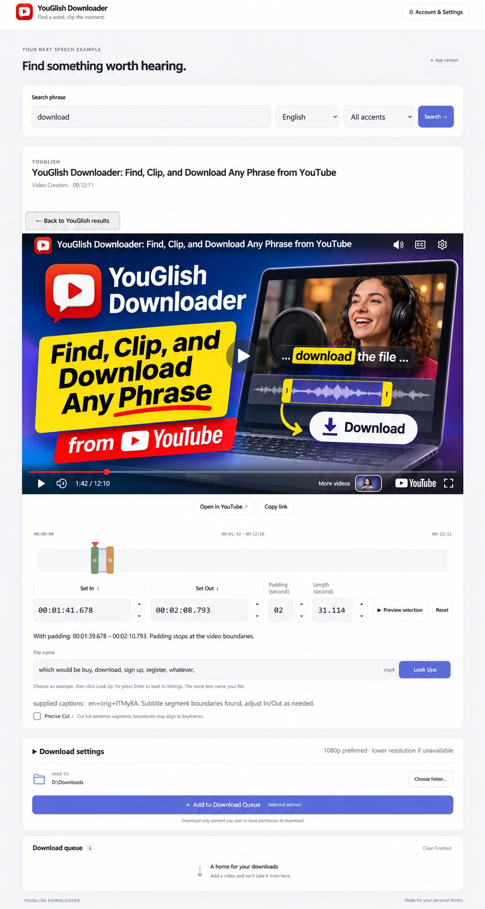

<!-- languages:start -->

<b>🌐 Language · Idioma · Langue · Sprache · Язык · 语言 · 言語 · 언어 · भाषा · لغة</b>

 

<table>
  <tr>
    <td align="center"><a href="../../README.md">English</a></td>
    <td align="center"><a href="README.ar.md">العربية</a></td>
    <td align="center"><a href="README.bn.md">বাংলা</a></td>
    <td align="center"><a href="README.zh-Hans.md">简体中文</a></td>
    <td align="center"><a href="README.fil.md">Filipino</a></td>
  </tr>
  <tr>
    <td align="center"><a href="README.fr.md">Français</a></td>
    <td align="center"><a href="README.de.md">Deutsch</a></td>
    <td align="center"><a href="README.hi.md">हिन्दी</a></td>
    <td align="center"><a href="README.id.md">Bahasa Indonesia</a></td>
    <td align="center"><a href="README.it.md">Italiano</a></td>
  </tr>
  <tr>
    <td align="center"><b>日本語</b></td>
    <td align="center"><a href="README.ko.md">한국어</a></td>
    <td align="center"><a href="README.fa.md">فارسی</a></td>
    <td align="center"><a href="README.pt-BR.md">Português (Brasil)</a></td>
    <td align="center"><a href="README.ru.md">Русский</a></td>
  </tr>
  <tr>
    <td align="center"><a href="README.es.md">Español</a></td>
    <td align="center"><a href="README.te.md">తెలుగు</a></td>
    <td align="center"><a href="README.th.md">ไทย</a></td>
    <td align="center"><a href="README.tr.md">Türkçe</a></td>
    <td align="center"><a href="README.vi.md">Tiếng Việt</a></td>
  </tr>
</table>

<!-- languages:end -->

# YouGlish Downloader

### 🎧 聞いて、切り取って、その瞬間を残す。

**実際の会話の中から任意の単語やフレーズを見つけ、正確なクリップを保存しましょう。** YouGlish Downloader は YouGlish の発音検索とデスクトップのクリッパーを組み合わせたものです。選んだ言語とアクセントでフレーズを検索し、文脈の中で人々が実際にどう発音しているかを聞いて、必要な瞬間だけをダウンロードできます。

- 🎓 **語学学習者：** 教科書の録音ではなく、実際の会話で本物の人がそれを話すのを聞けます。
- 👩‍🏫 **教師：** 授業に合わせて、すぐに再生できる例文クリップを作れます。
- 🔎 **フレーズを探している人：** 選んだ言語でそのフレーズが YouTube のどこで話されているかを見つけ、その瞬間だけを残せます。

ご自身が所有しているコンテンツ、またはダウンロードの許可を得ているコンテンツだけをダウンロードしてください。

公式の YouGlish ウィジェットで話し言葉の例を手作業で探すための TubeCutter のデスクトップ版です。このプロジェクトには独自のアプリ識別子と設定があります。

## ダウンロード

- **Windows：** [最新のリリースをダウンロード](https://github.com/MolecularDust/Youglish-Downloader/releases/latest)。通常のインストールかポータブル版を選べます。
- **macOS（Apple silicon）：** [macOS 版をダウンロード](https://github.com/MolecularDust/Youglish-Downloader/releases/tag/v0.3.0-macos)。

## YouTube へのアクセスを設定

1. アプリを開き、**Account & Settings** をクリックします。
2. **YouGlish playback account** の下で **1. Sign in to Google ↗**、次に **2. Connect YouTube ↗** をクリックし、求められたらチャンネルを選びます。終わったらアカウントのウィンドウを閉じます。**Check playback ↗** はサンプル動画を再生して、動作を確認します。
3. **Subtitle and download authentication** の下で、**Download authentication** に **App’s YouTube session** を選びます。

これで YouGlish Downloader を使えます。

代わりにサインイン済みのブラウザを使う場合は、**Download authentication** でそのブラウザを選びます。Windows では、検索の前にそのブラウザを閉じてください。Chromium 系ブラウザは実行中に Cookie ファイルをロックするため、Windows ではアプリ独自のセッションが確実な選択です。ご自身のアカウントだけを使い、他人の Cookie をインポートしたり共有したりしないでください。

**Anonymous** のままでも使えますが、匿名アクセスには YouTube のボット対策チェックがより厳しく適用され、一部の動画は失敗することがあります。

## 使い方

ビルド後に `src-tauri/target/debug/bundle/macos/YouGlish Downloader.app` を開くか、開発用に `npm run desktop` を実行します。

1. 検索フレーズ、言語、必要に応じてアクセントを入力し、検索します。既定はすべてのアクセントを含む英語です。
2. YouGlish で閲覧して聞きます。選んだサンプルの字幕が File Name に入り、再生中もそのまま残ります。
3. File Name を動画の字幕にあるフレーズに変更します。**Look Up** をクリックするか Enter を押します。欄を編集したり離れたりしても検索は始まりません。一致の処理が成功するか失敗するまで、ボタンにスピナーが表示されます。このテキストは出力ファイル名にもなります（拡張子はコンテナが付けます）。
4. 付属の字幕が優先されます。翻訳されていない元の自動字幕のみを代わりに使います。照合では大文字と小文字、句読点、アポストロフィの書式を無視し、隣接するキューにまたがって、重なり合うローリングテキストを除きます。
5. 動画を選ぶと、In/Out は最初にゼロと動画の全長に設定されます。一致が 1 つあると、それを含む字幕区間の境界に In/Out が設定されます（パディングなし）。複数一致の場合は出現箇所を 1 つ選ぶ必要があります。一致がなければ既存の時刻は変わりません。これらは字幕区間の境界であり、単語単位の音声の位置合わせではありません。
6. 小さな矢印で、どちらかの境界または長さを正確に 1 秒ずつ変更します。**Reset** は動画全体を元に戻し、無効な入力と検証エラーを消去します。無効な境界は拒否されます。タイムスタンプを直接入力したり、Length を入力したり（欄に表示されるパディング後のクリップの長さです。Out がそれに合わせて調整されます）、タイムラインをドラッグしたり、**Preview selection** を使ったりすることもできます。
7. **Preview selection** は、正確なシークのためにウィジェット領域を一時的に埋め込みの YouTube プレーヤーに切り替えます。**Back to YouGlish results** で閲覧に戻ります。**Set In** と **Set Out** には、YouGlish が文書化された絶対的な再生位置を提供しないため、このプレビューが必要です。
8. ダウンロード設定は最初は折りたたまれています。既定の解像度は 1080p 以下で利用可能な最大のものです。ダウンロード時には、1080p の要求で利用可能なより低いソース解像度も許容されます。それ以外に選んだ解像度は正確なまま扱われます。
9. 保存先フォルダーを選び、選択範囲を順次ダウンロードのキューに追加します。**Precise Cut**、一時停止・再開・キャンセル・再試行、字幕の埋め込み、Finder での表示はそのまま使えます。

**Account & Settings** は既定で匿名です。対応しているインストール済みのブラウザは、macOS の一般的なアプリの場所から検出されます。ブラウザを選ぶと、yt-dlp は字幕とダウンロードのためにそのブラウザのローカルな Cookie ストアを読み取れます。Cookie は YouGlish に注入されず、設定にも保存されません。ウィジェットは独自の WebView セッションを使います。アプリの設定とキューの識別情報は TubeCutter とは別です。

## 言語

アプリのインターフェースは英語と、ほかに 19 言語で利用できます：アラビア語、ベンガル語、中国語（簡体字）、フィリピン語、フランス語、ドイツ語、ヒンディー語、インドネシア語、イタリア語、日本語、韓国語、ペルシア語、ポルトガル語（ブラジル）、ロシア語、スペイン語、テルグ語、タイ語、トルコ語、ベトナム語です。既定ではシステムの言語に従います。別の言語を選ぶには **Account & Settings → Language** を開きます。選択はすぐに反映され、記憶されます。アラビア語とペルシア語は右から左に配置されます。

翻訳は `src/locales/<code>.json` にあり、英語の文章が鍵になります。翻訳を追加・修正する方法は[ローカライズの説明](../LOCALIZATION.md)を参照してください。

## 開発

ビルドに関する説明は英語のみです：[英語の README](../../README.md#development)をご覧ください。
